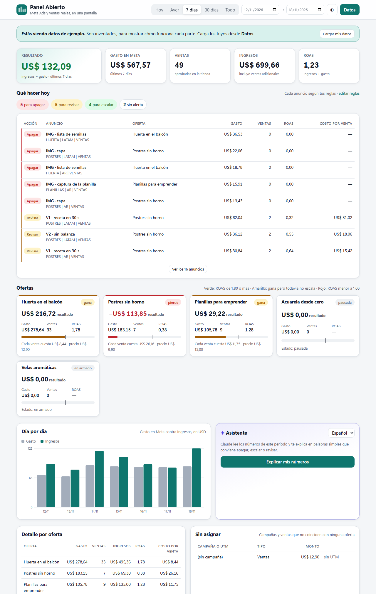
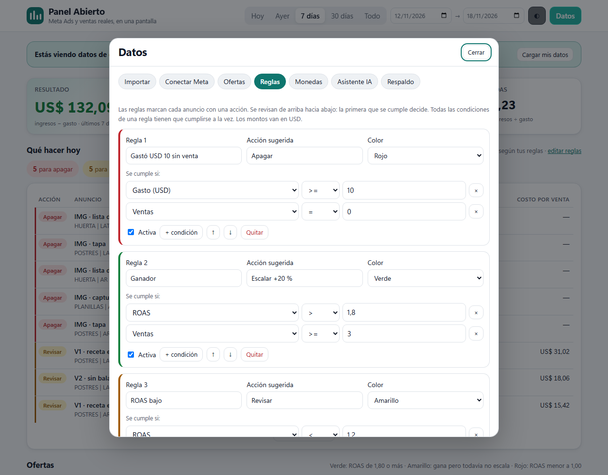
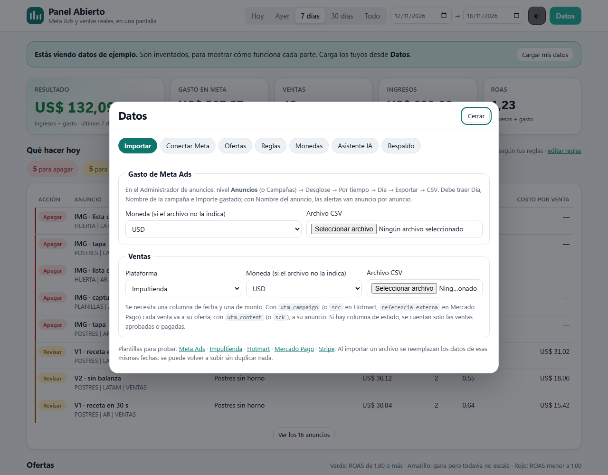
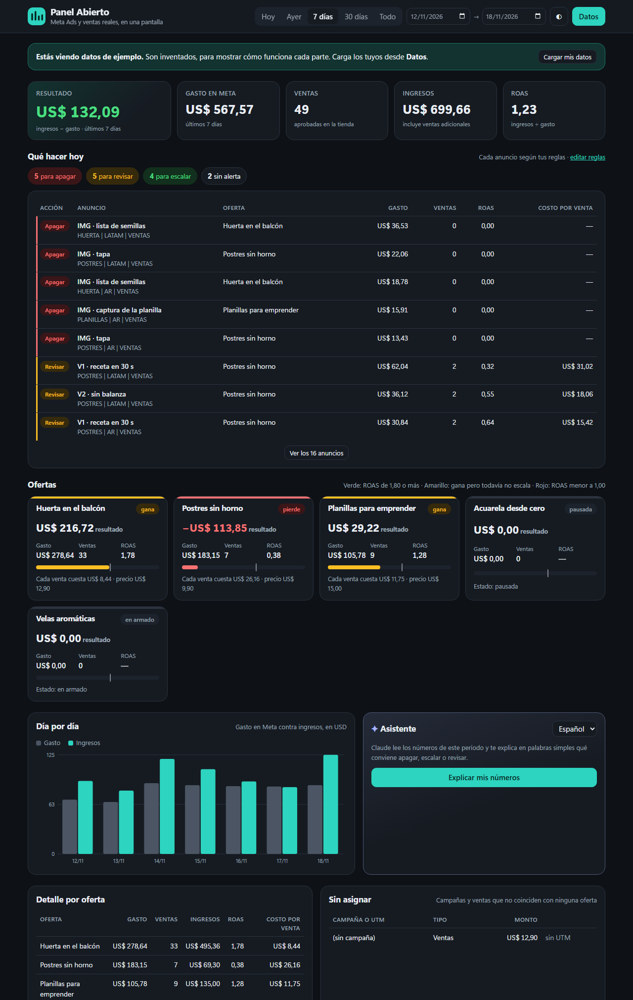
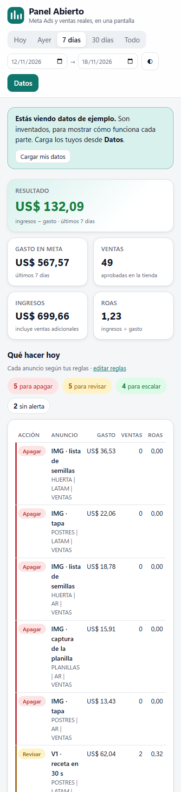

# Panel Abierto

**Español** · [English](#english)

Un panel **gratuito, en español y de código abierto** para quienes venden productos digitales (ebooks, cursos, plantillas) con anuncios de Meta. Junta en una sola pantalla lo que gastaste en Meta Ads y lo que vendiste **de verdad** en Impultienda, Hotmart, Mercado Pago o Stripe, te marca cada anuncio con lo que conviene hacer hoy y, si quieres, un asistente con IA te lo explica en palabras simples.

Funciona entero en tu navegador: **sin servidor, sin cuenta y sin suscripción**. Tus datos no salen de tu computadora.

**[Pruébalo en línea →](https://gaquaglierini-sys.github.io/panel-abierto/)** (arranca con datos de ejemplo inventados)

## El problema

El Administrador de anuncios cuenta las "compras" que vio el píxel. La plataforma de pago cuenta las ventas que entraron de verdad. Casi nunca coinciden. Las herramientas que cruzan las dos cosas cuestan entre 30 y 300 dólares por mes, están en inglés y están pensadas para tiendas de productos físicos.

Quien empieza vendiendo un ebook de 10 dólares en Argentina, México o Colombia termina con una planilla hecha a mano, o decide a ciegas cuándo escalar y cuándo apagar un anuncio. Panel Abierto resuelve eso.

## Qué hace

- **Ventas reales, no las del píxel.** Cruza el gasto de cada campaña y de cada anuncio con las ventas aprobadas, usando `utm_campaign` y `utm_content`.
- **Qué hacer hoy.** Reglas que tú defines ("gastó USD 10 sin venta", "ROAS menor a 1,2", "ROAS mayor a 1,8 con 3 ventas") marcan cada anuncio en rojo, amarillo o verde, con la acción sugerida: apagar, revisar o escalar. Vienen reglas de ejemplo y todas se pueden editar.
- **Asistente con IA.** Con tu propia clave de la API de Claude, el panel le pide a Claude que te explique los números del período y te recomiende qué hacer, en español o en inglés.
- **Varias plataformas y monedas.** Importa ventas de Impultienda, Hotmart, Mercado Pago, Stripe o cualquier CSV, en pesos, reales, euros o la moneda que sea, y lo convierte todo a dólares con las tasas que indiques.
- **Una tarjeta por oferta.** Resultado, gasto, ventas, ROAS y costo por venta contra el precio, con un medidor que marca el punto de escala.
- **"Sin asignar".** Muestra las campañas y ventas que no coinciden con ninguna oferta, para que no se pierda dinero en el camino. Con un clic se crea la oferta.
- **Pensado para América Latina:** lee números con coma decimal (`19,90`), fechas día/mes/año y el CSV de Meta en español.
- **Tema claro y oscuro**, y se ve bien en el celular.

| Reglas editables | Importar ventas de cada plataforma |
|---|---|
|  |  |

## Para quién

Emprendedores de América Latina que venden productos digitales con Meta Ads: ebooks, cursos, plantillas, membresías. También sirve para quien maneja campañas de otros y necesita mostrar números claros.

## Pruébalo en un minuto

- **En línea:** abre la [versión publicada](https://gaquaglierini-sys.github.io/panel-abierto/).
- **En tu computadora:** descarga este repositorio (**Code → Download ZIP**), descomprímelo y abre `index.html` con doble clic. No hace falta instalar nada.

Arranca con **datos de ejemplo inventados**. En **Datos → Importar** hay plantillas CSV de cada plataforma para probar la carga.

## Cómo cargar tus datos

### Gasto de Meta Ads

**Opción A, CSV (la más simple):** en el Administrador de anuncios, nivel **Anuncios** → **Desglose → Por tiempo → Día** → **Exportar → CSV**. Súbelo en **Datos → Importar**. Funciona con el export en español o en inglés, y toma la moneda del encabezado (por ejemplo `Importe gastado (ARS)`).

**Opción B, conexión directa:** en **Datos → Conectar Meta** pones el número de tu cuenta publicitaria y una clave de acceso con permiso `ads_read` (se obtiene en el Explorador de la API Graph de Meta). El panel le pide los datos directo a `graph.facebook.com` desde tu navegador. **La clave no se guarda en ningún lado**: se borra al cerrar la pestaña.

### Ventas

Exporta tus ventas a CSV y súbelas en **Datos → Importar**, eligiendo la plataforma:

| Plataforma | Fecha | Monto | Campaña | Anuncio | Estado que cuenta |
|---|---|---|---|---|---|
| Impultienda | `Fecha` | `Total` | `utm_campaign` | `utm_content` | Aprobado |
| Hotmart | `Fecha de la transacción` | `Precio total` | `SRC` | `SCK` | Aprobado, Completo |
| Mercado Pago | `Fecha de aprobación` | `Monto bruto de la operación` | `Referencia externa` | — | Aprobado |
| Stripe | `Created date (UTC)` | `Amount` | `utm_campaign (metadata)` | `utm_content (metadata)` | Paid |
| Otra | `fecha`, `date` | `total`, `monto`, `amount` | `utm_campaign` | `utm_content` | aprobado, pagado, paid |

Los nombres de columna de cada plataforma cambian con el idioma y con el tiempo. Si el panel no reconoce tu archivo, te muestra las columnas y eliges cuál es la fecha, cuál el monto y las demás. Las plantillas de [`ejemplos/`](ejemplos/) muestran el formato esperado (con datos inventados).

Para que cada venta caiga en su oferta y en su anuncio, tus anuncios tienen que mandar `utm_campaign={{campaign.name}}&utm_content={{ad.name}}` en la URL (en Hotmart, `src` y `sck`).

Si vuelves a subir un archivo, se reemplazan los datos **de esa misma plataforma** en esas fechas: no se duplica nada ni se pisan las otras.

### Monedas

Todo se muestra en dólares. En **Datos → Monedas** indicas cuántas unidades de cada moneda equivalen a 1 USD. Las tasas que vienen son de ejemplo: actualízalas con la cotización que uses. Si llega una moneda sin tasa, el panel te avisa.

### Ofertas y reglas

- **Ofertas:** cada oferta junta las campañas cuyo nombre **contiene** alguno de sus textos (sin importar mayúsculas ni tildes). La oferta "Huerta" con el texto `HUERTA` junta `HUERTA | MX | VENTAS` y `HUERTA | AR | VENTAS`.
- **Reglas:** se revisan de arriba hacia abajo y la primera que se cumple decide la acción. Cada regla tiene una o más condiciones sobre gasto, ventas, ROAS, ingresos o costo por venta, y todas tienen que cumplirse a la vez.

### Asistente con IA

1. Crea una clave en [console.anthropic.com](https://console.anthropic.com) → API Keys.
2. Pégala en **Datos → Asistente IA**. Puedes elegir si se recuerda en el navegador o no.
3. Toca **Explicar mis números**. Claude (modelo `claude-opus-5-5`) recibe un resumen con los números del período, sin nombres de clientes ni datos personales, y responde en el idioma que elijas.

La llamada va directo de tu navegador a `api.anthropic.com` y el uso se cobra en tu cuenta de Anthropic. La clave nunca se sube a otro lado ni entra en los respaldos.

## Privacidad

- Todo se guarda en el `localStorage` de tu navegador. No hay servidor propio.
- Las únicas conexiones externas son las que tú disparas: `graph.facebook.com` (si conectas Meta) y `api.anthropic.com` (si usas el asistente).
- **Respaldo:** en **Datos → Respaldo** descargas un `.json` con todo (sin claves) para pasarlo a otra computadora.

| Tema oscuro | Celular |
|---|---|
|  |  |

## Cómo está hecho

HTML, CSS y JavaScript sin frameworks ni dependencias, para que cualquiera lo pueda leer y cambiar.

| Archivo | Qué hace |
|---|---|
| `index.html` | La página |
| `src/csv.js` | Lee los CSV de Meta y de cada plataforma (separadores, comillas, números, fechas y monedas) |
| `src/meta.js` | Conexión directa a la API de Marketing de Meta |
| `src/calc.js` | Cálculos: asignar campañas a ofertas, conversión a USD, números por anuncio y reglas |
| `src/asistente.js` | El asistente con la API de Claude |
| `src/ejemplo.js` | Los datos y las reglas de ejemplo (inventados) |
| `src/app.js` | La pantalla y la ventana de datos |
| `tests/` | 21 pruebas: `npm test` (Node 18 o más nuevo, sin instalar nada) |

## Contribuir

Toda ayuda es bienvenida. Lee [CONTRIBUTING.md](CONTRIBUTING.md) y el [código de conducta](CODE_OF_CONDUCT.md). Las tareas para empezar están en los [issues marcados como *good first issue*](https://github.com/gaquaglierini-sys/panel-abierto/labels/good%20first%20issue).

## Licencia

[MIT](LICENSE). Úsalo, cámbialo y compártelo.

---

## English

**Panel Abierto** ("Open Panel") is a **free, Spanish-first, open-source** dashboard for people who sell digital products (ebooks, courses, templates) with Meta ads. It puts what you spent on Meta Ads next to what you **actually** sold on Impultienda, Hotmart, Mercado Pago or Stripe, flags every ad with what to do today, and, if you want, an AI assistant explains it in plain words.

It runs entirely in your browser: **no server, no account, no subscription**. Your data never leaves your computer.

**[Try it online →](https://gaquaglierini-sys.github.io/panel-abierto/)** (starts with made-up sample data). The interface is in Spanish; the assistant answers in Spanish or English.

### The problem

Ads Manager counts the "purchases" its pixel saw. The payment platform counts the sales that really came in. They rarely match, and the tools that reconcile both cost USD 30–300 a month, are English-only and built for physical-goods stores. A first-time seller of a USD 10 ebook in Argentina, Mexico or Colombia ends up with a hand-made spreadsheet, or decides blindly when to scale and when to turn off an ad.

### What it does

- **Real sales, not pixel sales.** Matches spend per campaign and per ad with approved sales via `utm_campaign` and `utm_content`.
- **What to do today.** Rules you define ("spent USD 10 with no sale", "ROAS below 1.2", "ROAS above 1.8 with 3 sales") flag each ad red, yellow or green with a suggested action: turn off, review or scale. Sample rules included, all editable.
- **AI assistant.** With your own Claude API key, the dashboard asks Claude to explain the period's numbers and recommend next steps, in Spanish or English.
- **Many platforms and currencies.** Imports sales from Impultienda, Hotmart, Mercado Pago, Stripe or any CSV, in any currency, and converts everything to USD with the rates you set.
- **One card per offer**, an **"Unassigned"** list so no money goes missing, **light and dark themes**, and a phone-friendly layout.
- **Built for Latin America:** decimal commas (`19,90`), day/month/year dates, and Meta's Spanish CSV export.

### Try it

Open the [online version](https://gaquaglierini-sys.github.io/panel-abierto/), or download this repository (**Code → Download ZIP**) and double-click `index.html`. Nothing to install. **Datos → Importar** has CSV templates for every platform.

### Loading your data

- **Meta Ads spend:** export a CSV from Ads Manager (Ads level → Breakdown → By time → Day → Export → CSV), or connect directly with your ad account number and an access token with `ads_read`. The token is never stored.
- **Sales:** pick the platform and upload its CSV export. If the columns are not recognized, the dashboard lets you map them by hand. Your ads should carry `utm_campaign={{campaign.name}}&utm_content={{ad.name}}` (`src` / `sck` on Hotmart). Re-uploading replaces only that platform's rows for the same dates.
- **Currencies:** everything is shown in USD; set how many units of each currency equal 1 USD under **Datos → Monedas** (the bundled rates are samples).
- **AI assistant:** create a key at console.anthropic.com, paste it under **Datos → Asistente IA** and click **Explicar mis números**. The request goes straight from your browser to `api.anthropic.com` (model `claude-opus-5-5`) with a numbers-only summary; usage is billed to your Anthropic account. The key never goes anywhere else and is excluded from backups.

### Privacy

Everything lives in your browser's `localStorage`. The only external calls are the ones you trigger: `graph.facebook.com` and `api.anthropic.com`. **Respaldo** (Backup) downloads everything except keys as a `.json` file.

### How it is built

Plain HTML, CSS and JavaScript with no frameworks and no dependencies. Run the 21 tests with `npm test` (Node 18+, nothing to install). See the file table above.

### Contributing

Contributions are welcome. Read [CONTRIBUTING.md](CONTRIBUTING.md) and the [code of conduct](CODE_OF_CONDUCT.md), and pick a [*good first issue*](https://github.com/gaquaglierini-sys/panel-abierto/labels/good%20first%20issue).

### License

[MIT](LICENSE).
